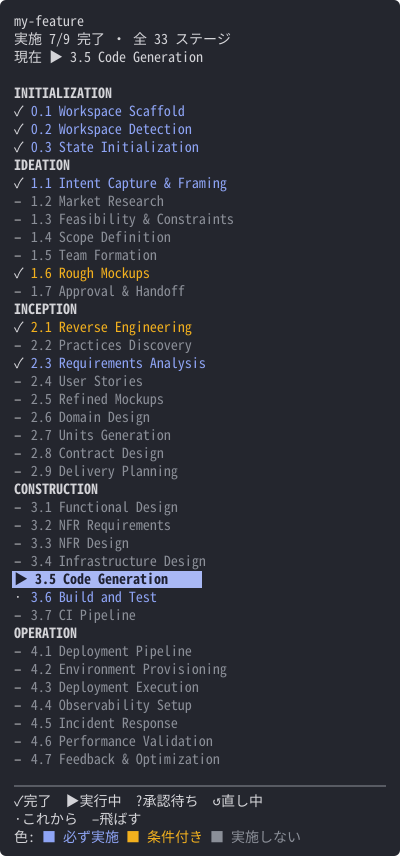

# aidlc-phase

A Claude Code mod that shows where an AI-DLC workflow is. By default it lists all 33 AI-DLC stages in a pane beside the chat: which stages this Intent runs, which it skips, how far each one is, and the stage under way. It can show one line below the prompt instead. Either way you keep your own statusLine; the project's statusLine does not have to be replaced by AI-DLC's.



The one-line display:

```
⚠ aidlc-phase: [AIDLC] my-feature · INCEPTION [▓▓▓░░░░░░░] 3/9 > User Stories
```

The mod is `hooks/register.tsx`. It reads the AI-DLC files in `hooks/progress.ts` and draws the pane in `hooks/pane.tsx`; the values the pane draws from are declared in `types/index.d.ts`. Each has its tests beside it (`*.test.ts`, `*.test.tsx`, with shared test data in `hooks/fixtures.ts`). The repository is also the marketplace (`.claude-plugin/`).

## When it runs

- Only when the working folder or one of its parents has an `aidlc/` folder (an AI-DLC project). Anywhere else it runs nothing and shows nothing
- Function hooks must be enabled (`CLAUDE_CODE_ENABLE_FUNCTION_HOOKS=1`)
- The Intent shown is the one AI-DLC's own status line shows; the pane looks up its record in the space's `intents.json`

## The pane

- It opens by itself when a session starts in the fullscreen layout. Claude Code places a pane it was not asked for once the terminal is 144 columns wide (110 once you have opened it yourself); until then the one-line display shows instead, and it goes as soon as the pane is drawn
- On the main screen (not fullscreen) it does not open by itself and the one-line display shows. `/aidlc-phase` opens it there too, above the prompt
- `/aidlc-phase` opens it at any width
- Once you close it, neither the pane nor the line shows for the rest of the session, until `/aidlc-phase` opens it again
- It is updated when the session starts and at the end of each reply
- When the height does not fit every stage, finished phases fold into one row each, then the skipped stages of each phase into one row
- When the newest state cannot be read, the last list stays with a note above it; with nothing read before, the pane says how to check (`/aidlc --doctor`)

Known limits:

- A change of terminal height alone does not redraw the pane, so the folding follows the height as of the last width change
- When a pane opened by `/aidlc-phase` stops being placed, the one-line display comes back at the end of the next reply

## Settings

`display` picks how it shows: `pane` (the default) or `statusline` (one line below the prompt, as before the pane existed). Change it in `/config`.

With `statusline`, when no workflow is in progress (`[AIDLC] ready`), the line is hidden.

## Install

Run these in the folder of a project that uses AI-DLC:

```bash
claude plugin marketplace add 70-10/aidlc-phase --scope local
claude plugin install aidlc-phase@aidlc-phase --scope local
```

`--scope local` writes to `.claude/settings.local.json` of the repository. Even when run in a subfolder, it writes to the git root.

Auto-update is off by default for this marketplace. To receive updates automatically, turn on auto-update for it in the `/plugin` screen.

## Test

```bash
claude plugin validate .
claude plugin test .
```
